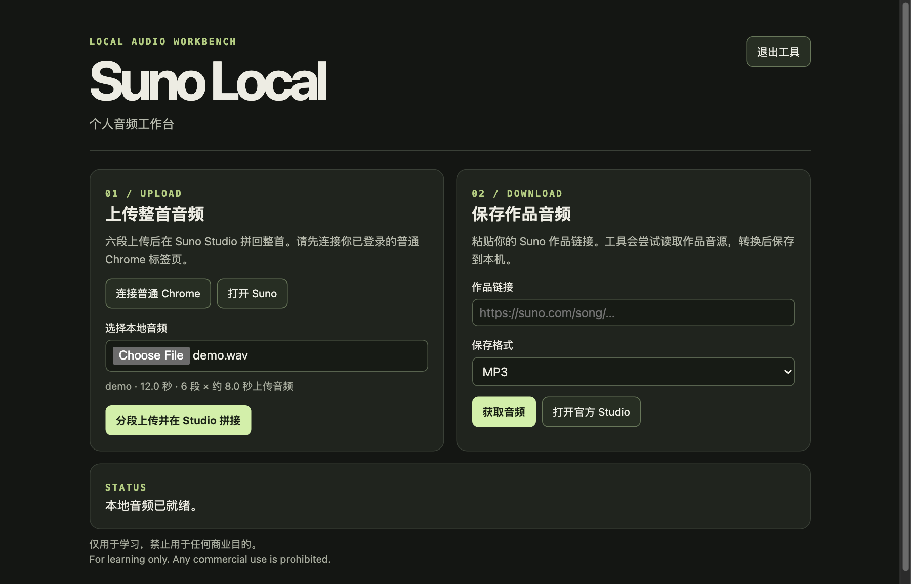

# Suno Local

**A desktop workbench for studying audio workflows with Suno. For noncommercial learning only.**

[简体中文](README.zh-CN.md) · [Features](#features) · [Downloads](#downloads) · [Quick start](#quick-start) · [Workflow](#workflow) · [Build from source](#build-from-source) · [Usage terms](#usage-terms)

## Features

**Bring your recordings into Suno for covers and rearrangements.** When Suno announced v6, it described copyright screening for uploaded audio and lyrics. Suno's upload rules apply to paid accounts as well. If your own recording or licensed material gets flagged, keep your original project or permission records and check with Suno. For guitar recordings, original demos, or licensed cover material that can be uploaded, Suno Local handles the manual work of cutting six clips, uploading them, and arranging them in an editable Studio project. Suno decides whether to accept the uploads. [Suno v6 announcement](https://suno.com/blog/introducing-v6) · [Suno moderation overview](https://suno.com/safety)

**Save a local copy of your audio.** As of November 8, 2026, Suno Pro includes 20 official song downloads per month. Downloading the same song again or in another format uses no additional allowance. Given a song link, Suno Local can try to save an available playback source as WAV or MP3. The app has no monthly save counter of its own. Saving depends on source availability and is subject to Suno's terms. [Suno download allowances](https://help.suno.com/en/articles/13926209) · [Usage terms](#usage-terms)



## Downloads

| Platform | Installer |
| --- | --- |
| Windows 11 x64 | [Download Setup.exe](https://github.com/the13thhuhuzu/suno-local/releases/download/v0.2.0/Suno-Local-0.2.0-Windows11-x64-Setup.exe) |
| macOS 13.5+ on Apple Silicon | [Download .pkg](https://github.com/the13thhuhuzu/suno-local/releases/download/v0.2.0/Suno-Local-0.2.0-macOS-arm64.pkg) |

[Release notes, SHA-256 checksums and dependency sources](https://github.com/the13thhuhuzu/suno-local/releases/tag/v0.2.0). Node.js, FFmpeg and ffprobe come with the installer. Install Google Chrome separately. The installers do not have publisher signing or Apple notarization, so your OS may block them or show a warning. The Windows installer has been inspected without a full install test on Windows 11.

## Quick start

1. Run the installer for your platform. Open **Suno Local** from **Applications** on macOS or from **Start** on Windows. The interface opens in your default browser.
2. Sign in to your own Suno account in Google Chrome. Go to `chrome://extensions`, enable **Developer mode**, and use **Load unpacked** to select the bundled extension folder.
   - macOS — `/Applications/Suno Local.app/Contents/Resources/chrome-link`
   - Windows — `%LOCALAPPDATA%\Programs\Suno Local\chrome-link`
3. Click **连接普通 Chrome** in the workbench and copy the pairing address. On your signed-in Suno tab, click **Suno Local Link**, paste the address and connect. Keep the connection page open while uploading.
4. To upload, select a local file and click **分段上传并在 Studio 拼接**. To save audio, paste your own Suno song link, choose WAV or MP3 and click **获取音频**. Click **保存音频文件** when it is ready.

## Workflow

| Action | What happens |
| --- | --- |
| Prepare and upload | FFmpeg encodes six clips locally. The Chrome extension uses your existing Suno tab to upload the clips under your account. |
| Reassemble in Studio | The app places the clips on two tracks, restores playback speed, and requests a full render. Open the Studio project to edit it. |
| Save audio | The workbench retrieves a playback source and can convert it to WAV or MP3. WAV conversion does not restore details lost in a lossy source. |

The extension requests temporary access to the active tab and access to the local loopback server. Your account session stays in Chrome. The app accepts files from 9 seconds through 12 minutes for splitting, subject to Suno’s current limits and your account permissions. A 5-minute-29-second upload and render was verified. Longer inputs, including the 12-minute boundary, have not been tested against Suno.

## Build from source

On the Apple Silicon build host, install Python 3, Xcode Command Line Tools and [Zig 0.15.2](https://ziglang.org/download/). Put Zig on PATH or set `ZIG` to the executable’s path.

```sh
python3 packaging/fetch.py
./packaging/build-installers.sh
```

Run `node --test smoke.test.mjs` with FFmpeg and ffprobe on PATH to exercise the local workflow and a simulated Suno interface. The [third-party component notes](packaging/Sources.txt) link the bundled tools to their sources and build recipes.

## Usage terms

**For learning only. Any commercial use is prohibited.** Use only audio you have the right to process. This project is independent of Suno. The usage notice does not grant permission to override Suno’s terms, limits or access controls. The playback-source feature uses a channel outside official export, which Suno’s terms prohibit for obtaining output. Use Suno’s official export when downloading from the service. [Suno Terms of Service](https://suno.com/terms)

The [learning-use license](LICENSE) covers the original application. Bundled Node.js, FFmpeg, ffprobe and LAME retain their own licenses. This is a source-available release with a noncommercial restriction.
