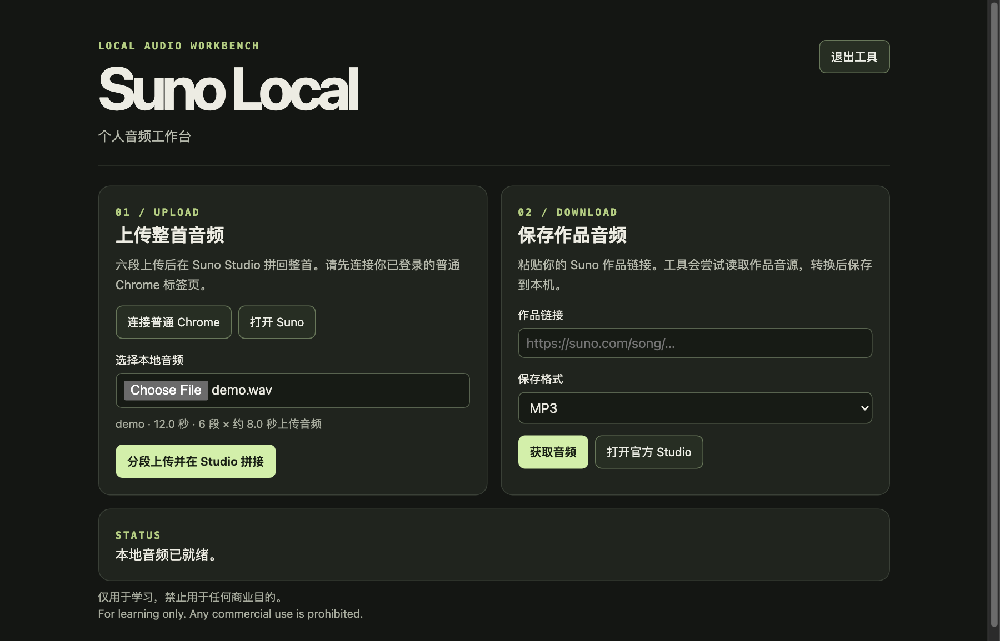

# Suno Local

**用于学习 Suno 音频工作流程的桌面工具。仅限非商业学习用途。**

[English](README.md) · [功能介绍](#功能介绍) · [下载安装](#下载安装) · [快速上手](#快速上手) · [工作流程](#工作流程) · [从源码构建](#从源码构建) · [使用边界](#使用边界)

## 功能介绍

**把自己的录音带进 Suno 做二创。** Suno 在发布 v6 时介绍了对上传音频和歌词的版权筛查，付费账号也要遵守平台的上传规则。如果你自己的录音或已获授权的素材也遇到版权提示，可以保留原始工程或授权凭证，向 Suno 核实。对于可上传的吉他录音、原创小样或已获授权的翻唱素材，Suno Local 会自动切成六段、分别上传，再在 Studio 拼回可编辑的工程，省去手动切片和对齐的步骤。上传结果仍由 Suno 决定。 [Suno v6 公告](https://suno.com/blog/introducing-v6) · [Suno 内容审核说明](https://suno.com/safety)

**把作品音频带回本机。** 截至 2026 年 11 月 8 日，Suno Pro 的官方额度为每月 20 首。同一首歌重复下载或换格式不重复扣额度。Suno Local 可以尝试从作品链接读取可用的播放音源并保存为 WAV 或 MP3。工具本身没有每月保存计数，实际能否保存取决于音源是否可访问，也受 Suno 使用条款约束。 [Suno 下载额度说明](https://help.suno.com/en/articles/13926209) · [使用边界](#使用边界)



## 下载安装

| 系统 | 安装包 |
| --- | --- |
| Windows 11 x64 | [下载 Setup.exe](https://github.com/the13thhuhuzu/suno-local/releases/download/v0.2.0/Suno-Local-0.2.0-Windows11-x64-Setup.exe) |
| macOS 13.5 或更新版本，Apple Silicon 芯片 | [下载 .pkg](https://github.com/the13thhuhuzu/suno-local/releases/download/v0.2.0/Suno-Local-0.2.0-macOS-arm64.pkg) |

[发布说明、SHA-256 校验文件和第三方源码](https://github.com/the13thhuhuzu/suno-local/releases/tag/v0.2.0)。安装包内置 Node.js、FFmpeg 和 ffprobe。Google Chrome 需单独安装。安装包没有发行者签名或 Apple 公证，系统可能提示风险或拦截。Windows 包已做解包检查，尚未在 Windows 11 上完成实机安装测试。

## 快速上手

1. 运行对应安装包。安装后从 Mac 的「应用程序」或 Windows 的「开始」菜单打开 **Suno Local**，默认浏览器会显示工作台。
2. 用 Google Chrome 登录自己的 Suno 账号。打开 `chrome://extensions`，启用「开发者模式」，点击「加载已解压的扩展程序」，选择安装目录里的扩展文件夹。
   - macOS — `/Applications/Suno Local.app/Contents/Resources/chrome-link`
   - Windows — `%LOCALAPPDATA%\Programs\Suno Local\chrome-link`
3. 在工作台点「连接普通 Chrome」并复制连接地址。切回已经登录的 Suno 标签页，打开 **Suno Local Link**，粘贴地址并连接。上传时保持连接页打开。
4. 上传时选择本地音频，再点「分段上传并在 Studio 拼接」。保存音频时粘贴自己的 Suno 作品链接，选 WAV 或 MP3，依次点「获取音频」和「保存音频文件」。

## 工作流程

| 操作 | 内部机制 |
| --- | --- |
| 分段并上传 | FFmpeg 在本机编码六个片段。Chrome 扩展通过你已登录的 Suno 标签页上传素材。 |
| 在 Studio 拼接 | 工作台将片段交错放在两条轨道，恢复播放速度并提交整首渲染。可以打开 Studio 工程继续编辑。 |
| 保存音频 | 工作台读取播放音源并转换成 WAV 或 MP3。有损音源转 WAV 无法恢复压缩时丢掉的细节。 |

扩展申请临时活动标签页和本机回环地址权限，账号会话留在 Chrome 内。工具接受 9 秒到 12 分钟的分段输入，实际上传受 Suno 接口和账号权限限制。已实测上传、拼接并渲染一段 5 分 29 秒的音频，较长输入和 12 分钟上限尚未在 Suno 实测。

## 从源码构建

在 Apple Silicon Mac 上安装 Python 3、Xcode Command Line Tools 和 [Zig 0.15.2](https://ziglang.org/download/)。将 Zig 加入 PATH，或用 `ZIG` 指定其可执行文件的路径。

```sh
python3 packaging/fetch.py
./packaging/build-installers.sh
```

终端能调用 FFmpeg 和 ffprobe 时，可运行 `node --test smoke.test.mjs` 验证本机流程和模拟的 Suno 接口。随包组件的源码与构建脚本见[第三方组件说明](packaging/Sources.txt)。

## 使用边界

**仅用于学习，禁止用于任何商业目的。** 请只处理你有权使用的音频。项目独立于 Suno。用途声明不构成 Suno 对其条款、用量限制或访问控制的豁免。播放音源保存功能走的是官方导出之外的渠道，Suno 条款禁止通过这类渠道获取输出。需要下载时请遵守 Suno 条款并使用其官方导出渠道。 [Suno 服务条款](https://suno.com/terms)

[学习用途许可](LICENSE)适用于本项目的原创应用。随包分发的 Node.js、FFmpeg、ffprobe 和 LAME 仍适用各自的许可。完整版采用可查阅源码、禁止商用的发布方式。
